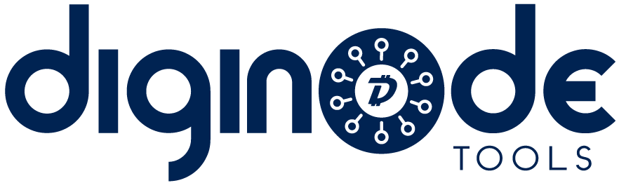
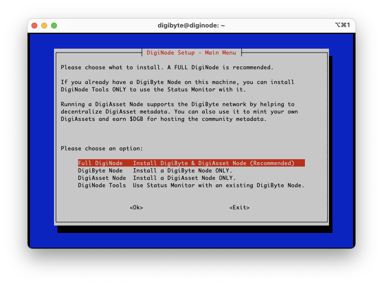
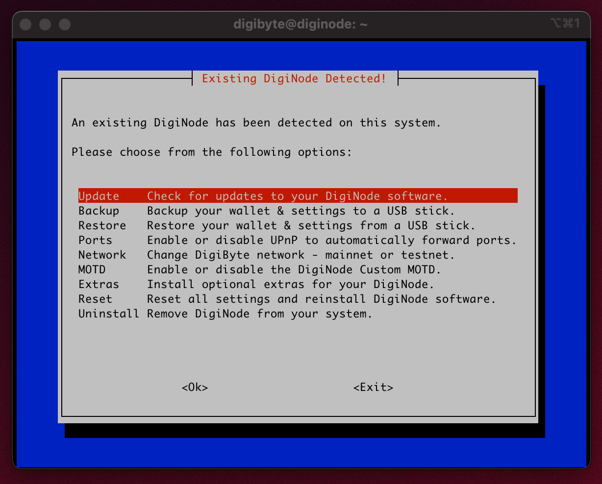
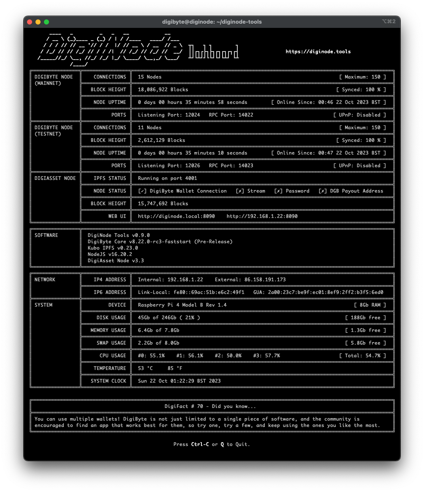

# DigiNode Tools

### What's a DigiNode?
A DigiNode is a device that runs a [DigiByte](https://digibyte.org/) Full Node and [DigiAsset Node](https://ipfs.digiassetx.com/) helping to further decentralize the DigiByte ecosystem. 

### What are DigiNode Tools?
DigiNode Tools are a suite of Linux bash scripts that make it really easy to setup, monitor and manage a DigiNode on a Raspberry Pi 4 or Ubuntu/Debian system.
- **DigiNode Setup** - Helps you to install, upgrade, backup and restore your DigiByte and/or DigAsset Node.
- **DigiNode Dashboard** - Provides a live dashboard to quickly check the status of your DigiNode.

Learn more: [https://diginode.tools](https://diginode.tools)

### What do I need to run a DigiNode?

- A **Raspberry Pi 4 8Gb** is the recommended device for running a DigiNode. It offers the most user-friendly setup experience. See [here](https://diginode.tools/build-your-own-raspberry-pi-diginode/) for the parts you need.
- DigiNode Tools also runs on most Ubuntu or Debian based systems. ARM64 and x86_64 hardware are both supported. A 64-bit OS is required. For more info, see the [System Requirements](https://diginode.tools/system-requirements/) on the official website.
- DigiNode is designed to operate headless - i.e. no display, keyboard or mouse is required. Everything can be managed remotely from your main computer. (Note: These may be needed during setup on some Linux systems, but are not needed at all for the Raspberry Pi 4.)

<!-- sponsors:featured -->
## Featured Sponsors

<!-- /sponsors:featured -->

## About DigiNode Tools

DigiNode Setup helps you to setup and manage your DigiNode:

- Intuitively walks you though the process of setting up a DigiByte Node and/or DigiAsset Node. 
- Designed with less-technical users in mind - almost no linux command line experience required. Setup is entirely menu-driven.
- Checks your system hardware and OS are compatible, and that there is sufficient disk space, memory and swap.
- Install a mainnet or testnet DigiByte Node, or a Dual Node - run both simultaneously on the same system!
- Automatic configuration - sets up optimal digibyte.conf, systemd services, RPC credentials, zero conf networking, UPnP port forwarding, custom MOTD etc.
- Supports installing DigiByte Core pre-releases (Optional)

Manage you DigiNode via simple menus. Easily install software updates. Backup and restore. Uninstall and repair and more:

Includes DigiNode Dashboard, a powerful tools for monitoring the status of your DigiByte and DigiAssets nodes:

# ➡️ GET STARTED

- Go [here](https://diginode.tools/raspberry-pi-setup/) for detailed step-by-step instructions on how to setup a DigiNode on a Raspberry Pi 4.
- Go [here](https://diginode.tools/#getstarted) for how to setup a DigiNode on an Ubuntu or Debian system.

## Support

If you need help, please join the [DigiNode Tools Telegram group](https://t.me/DigiNodeTools). You can also contact [@diginode.tools](https://bsky.app/profile/diginode.tools) on Bluesky.

<!-- sponsors:support -->
## Sponsor DigiNode Tools

I created DigiNode Tools to make it easy for everybody to run their own DigiByte Node. It's free and open source, and I build and maintain it in my spare time. The more people who sponsor me, the more time I can devote to it.

**[Sponsor DigiNode Tools on GitHub](https://github.com/sponsors/DigiNode-Tools)**. You can sponsor monthly or make a one-time donation, from as little as you like.

- **Patron** ($100 a month): your name on the [sponsors page](https://diginode.tools/sponsors/), linked to your GitHub profile if you like.
- **Featured Sponsor** ($300 a month, only 3 places): for businesses and projects. Your logo and link on the [diginode.tools](https://diginode.tools) home page and sponsors page, and on the [DigiNode Tools GitHub page](https://github.com/DigiNode-Tools/diginode-tools), plus your name and link shown to everyone using DigiNode Setup and DigiNode Dashboard. Featured Sponsors are approved by me. If your sponsorship isn't approved, it will be refunded. After sponsoring, [add your logo using this form](https://github.com/DigiNode-Tools/diginode-sponsors/issues/new?template=featured-sponsor.yml).

To see what your support helps with, and what I hope to work on next, visit [diginode.tools/sponsors](https://diginode.tools/sponsors/).

### Donate DigiByte

Prefer to donate DGB? Scan the QR code, or send it to:

`dgb1qv8psxjeqkau5s35qwh75zy6kp95yhxxw0d3kup`

Thank you for your support! You can find me on Bluesky [@olly.st](https://bsky.app/profile/olly.st).

Olly
<!-- /sponsors:support -->

## Release Notes

Go [here](https://diginode.tools/release-notes/) to view the release notes.

## Disclaimer

These tools are provided as is. Use at your own risk. Always keep a backup of your DigiByte wallet. 

## Licence

DigiNode Tools is free to use for any purpose, and its code is public so anyone can see exactly what it does. It's licensed under the [PolyForm Perimeter 1.0.0](LICENCE.md) licence, which doesn't allow the code to be used to make a competing product, including a version for another blockchain. See the [Licence FAQ](docs/licence_faq.md) for a plain-English summary.

The DigiNode Tools name and logo can be used to link to or write about DigiNode Tools - see [TRADEMARKS.md](TRADEMARKS.md).

